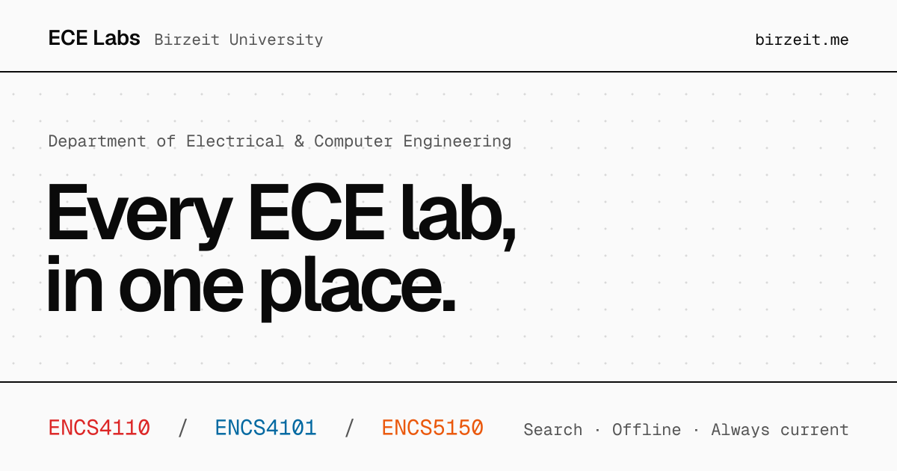

<a href="https://birzeit.me"></a>

# ECE Lab Manuals · birzeit.me

The landing page at [birzeit.me](https://birzeit.me) that lists every lab manual of the Department of Electrical & Computer Engineering at Birzeit University, with search across lab codes, boards and topics.

**[Open birzeit.me](https://birzeit.me)** · [ENCS4110](https://encs4110.birzeit.me) · [ENCS4101](https://encs4101.birzeit.me) · [ENCS5150](https://encs5150.birzeit.me)

## Run it locally

There is no build step. Open `index.html` in a browser, or serve the folder:

```sh
git clone https://github.com/ECE-Birzeit/landing-page.git
cd landing-page
python3 -m http.server 8000   # http://localhost:8000
```

## Project layout

| Path | Contents |
|:--|:--|
| `index.html` | The whole page: markup, styles, theme switch, search, analytics |
| `og.png` | Link-preview image |
| `favicon.png`, `apple-touch-icon.png` | Icons |
| `sitemap.xml`, `robots.txt` | Search engine files, with sitemaps for all four sites |
| `CNAME` | `birzeit.me` |
| `.github/workflows/deploy.yml` | Stamps the last-updated date and deploys to GitHub Pages |

### Adding a lab

Copy one of the `<article class="lab">` blocks in `index.html` and update:

- `data-lab`, `data-code` and `data-url`
- `data-search`, the words the search box matches
- the text, the links, and the "Lab 0N" number
- the lab's accent colors, in the two `.lab[data-lab=…]` rules (light and dark theme)

Then add the lab to the structured data (`application/ld+json`) and its sitemap to `robots.txt`.

## Contributing

[Open an issue](https://github.com/ECE-Birzeit/landing-page/issues/new/choose) or send a pull request. The [contributing guide](https://github.com/ECE-Birzeit/.github/blob/main/CONTRIBUTING.md) covers the rest.

## Deployment

On every push to `main`, `.github/workflows/deploy.yml` writes the latest commit date into the footer and the sitemap, then deploys to GitHub Pages at [birzeit.me](https://birzeit.me).

## License

[MIT](LICENSE) © Mohammad Abu-Shelbaia. The Birzeit University name and logo are the university's; they are not licensed here.

---

<sub>Part of [ECE Lab Manuals](https://birzeit.me) · Maintained by [Mohammad Abu-Shelbaia](https://github.com/mabushelbaia)</sub>
