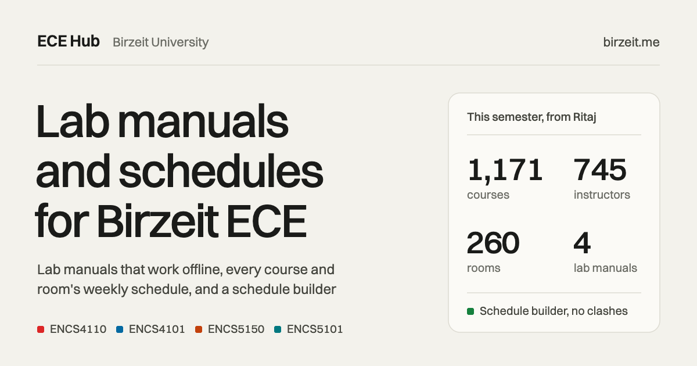

<a href="https://birzeit.me"></a>

# ECE Hub · birzeit.me

The site at [birzeit.me](https://birzeit.me) for students of the Department of Electrical & Computer Engineering at Birzeit University: the lab manuals, the weekly schedule of every course, instructor and room, and a schedule builder for registration.

**[Open birzeit.me](https://birzeit.me)** · [ENCS4110](https://encs4110.birzeit.me) · [ENCS4101](https://encs4101.birzeit.me) · [ENCS5150](https://encs5150.birzeit.me) · [ENCS5101](https://encs5101.birzeit.me)

## Run it locally

The site is built with [Astro](https://astro.build) (Node 22 or later):

```sh
git clone https://github.com/ECE-Birzeit/landing-page.git
cd landing-page
npm install
npm run dev       # http://localhost:4321, reloads as you edit
npm run build     # the finished site in dist/
npm run preview   # serve dist/
```

`/stats.json` is written by the deploy, so the numbers on the home and insights pages fall back to their defaults locally. Copy `https://birzeit.me/stats.json` into `dist/` (or `public/`) to see real ones.

## Project layout

| Path | Contents |
|:--|:--|
| `src/layouts/Base.astro` | What every page shares: the `<head>` (meta and link-preview tags, icons, fonts, analytics, the theme set before first paint), the header with the nav, and the footer. Pages pass their title, description, path and nav item, add to the head through `slot="head"` and add footer links through `slot="footer"` |
| `src/components/Jump.astro` | The search box in the header (⌘K / Ctrl+K, or `/`): finds any page, lab, course, instructor or room and opens it; ⌘↵ on a course adds it to the schedule builder (`/timetable/?add=CODE`). Courses, instructors and rooms come from the bzu-course-catalog term file, loaded the first time the box opens; the last five picks are kept in `localStorage` under `ece-jump-recent` |
| `src/styles/base.css` | Shared styles: reset, the colour tokens for the light and dark themes, type, the header and the footer. One font, Switzer, on every page |
| `src/pages/index.astro` | The home page at `/`: a text hero with this semester's panel (week, bar to the exams, the hub's counts), the featured laboratories as a sideways row of cards, what the web manuals do, the schedules and the schedule builder with real examples, this semester in numbers, and the call for manuals. Motion uses [GSAP](https://gsap.com) 3.12.5 and ScrollTrigger from cdnjs with integrity hashes; nothing moves for reduced motion, and the page is complete without the scripts |
| `src/pages/labs/index.astro` | Every lab at `/labs/`, with search and filters for type, language and year, drawn from `public/labs/labs.json` |
| `src/pages/schedules/index.astro` | The weekly schedules at `/schedules/`: browse by instructor, course or room, with a sortable sections table. Reads the live JSON from [bzu-course-catalog](https://github.com/mabushelbaia/bzu-course-catalog) in the browser, so it stays current without redeploys |
| `src/pages/timetable/index.astro` | The schedule builder at `/timetable/`: pick courses and step through every clash-free combination of sections, with filters, per-section switches, a calendar (`.ics`) export and a shareable link. Choices are kept in `localStorage` under `ece-timetable` |
| `src/pages/stats/index.astro` | The insights page at `/stats/`, drawn from `/stats.json` |
| `public/` | Files served as they are: icons, `og.png` and its source `og.svg`, `sitemap.xml`, `robots.txt`, `CNAME`, `labs/labs.json`, the chart widgets in `assets/` (shared by the home and insights pages), and the frozen old designs in `v1/`, `v2/` and `legacy/` |
| `scripts/stats.py` | Writes `/stats.json` during the deploy: manuals, experiments and code listings from the four lab repos, plus visitors from Google Analytics (keyless sign-in) counted from the semester's first teaching day |
| `.github/workflows/deploy.yml` | Builds the site, stamps the sitemap, writes `stats.json` and deploys to GitHub Pages |

The pages keep their scripts as plain JavaScript (`<script is:inline>`) and their styles as global CSS (`<style is:global>`), because most of what they style is drawn by those scripts at run time.

### Adding a lab

1. Add it to `public/labs/labs.json` (`id`, `code`, `name`, `url`, `pdf`, `setup`, `kind`, `langs`, `platform`, `boards`, `topics` and its `accent` colours for the light and dark theme) so it shows on `/labs/`.
2. To feature it on the home page, copy one of the `<article class="lab">` cards in `src/pages/index.astro` and change its `data-lab`, `data-code`, number, name, platform line and three links; add its accent colours to the `[data-lab=…]` rules in `src/styles/base.css`. The row, its counts and the usage numbers follow on their own.
3. Add it to the structured data (`application/ld+json`) in `src/pages/index.astro` and its sitemap to `public/robots.txt`.

### Versions

Old designs are frozen as plain files in `public/vN/` with `<meta name="robots" content="noindex">`, reachable at their folder but not linked from the site.

### Link preview

`public/og.png` is rendered from `public/og.svg` at 1200×630 in a browser engine, which loads Switzer from Fontshare.

## Contributing

[Open an issue](https://github.com/ECE-Birzeit/landing-page/issues/new/choose) or send a pull request. The [contributing guide](https://github.com/ECE-Birzeit/.github/blob/main/CONTRIBUTING.md) covers the rest.

## Deployment

On every push to `main`, and once a day, `.github/workflows/deploy.yml` builds the site with Astro, writes the latest commit date into the sitemap, counts the platform into `stats.json` and deploys `dist/` to GitHub Pages at [birzeit.me](https://birzeit.me). The footer's "Updated" date is the latest commit's, read at build time.

## License

[MIT](LICENSE) © [Mohammad Abu-Shelbaia](https://mabushelbaia.com). The Birzeit University name and logo are the university's; they are not licensed here.

---

<sub>Part of [ECE Labs](https://birzeit.me) · Maintained by [Mohammad Abu-Shelbaia](https://mabushelbaia.com)</sub>
